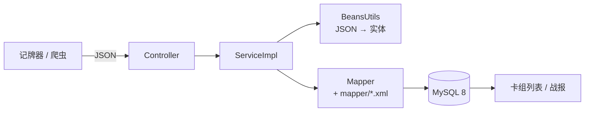

# GwentMirrorService · 卡组与战报服务

**记牌器上报一局 → 拆成四张表落库 → 网站按卡牌搜到这套牌。**

昆特牌站点要回答「哪套牌带这张卡」，得先把零散的对局攒成结构化的卡组。
这个 Spring Boot 服务就是攒数据的地方：接记牌器战报、接爬虫批量卡组、对外提供按卡牌反查卡组的接口。
单表最大的 `deck` 用牌表哈希当主键，重复上报不会让表膨胀。

   

```text
POST /battle/api/save  →  player + deck + battle + 2×player_battle_info   （一个事务写完）

+---------------------+-------+
| deck                | 497   |   ← 477 样例 + 爬虫新增 + 回放产生的
| battle              | 8     |   ← 每局一行
| player              | 6     |   ← service_id 去重
| player_battle_info  | 16    |   ← 每局两条（左右各一）
+---------------------+-------+
```

## 这是什么

1. 记牌器打完一局，把双方牌表与回合比分 POST 过来（报文就是内存里读到的原始结构）；
2. 爬虫从官网批量灌卡组，同一套牌只存一行；
3. 网站按「包含这些牌」反查，接口由本服务提供。

它是一体化镜像里的那个 Java 进程（端口 8081），也可以单独跑。

## 能干什么

- **一局战报一次事务落四表** —— battle 拿主键 → 两条战报插入 → 回填左右 id，中途失败整局回滚
- **同一套牌只存一行** —— 牌表集合的哈希当主键，`ON DUPLICATE KEY UPDATE` 只累加命中次数
- **按包含卡牌检索** —— `LOCATE(卡牌id, cards)`，一条 SQL 支持「同时包含这几张牌」
- **爬虫增量灌库** —— `/deck/api/maxid` 给水位，爬虫只拉比它新的
- **给客户端判版本** —— `/version/api/getId` 返回版本记录，客户端据此决定是否更新本地卡组库

## Quick Start

前提：JDK 8+、Maven 3.6+、本地 MySQL 8。

```bash
mysql -uroot -p -e "CREATE DATABASE GwentMirror CHARACTER SET utf8mb4 COLLATE utf8mb4_0900_ai_ci;"
mysql -uroot -p GwentMirror < GwentMirror.sql
# 改 src/main/resources/application.yml 的 datasource（仓库里默认指向作者的线上库）
mvn spring-boot:run
curl -s http://localhost:8081/deck/api/maxid
```

不想装 JDK？用一体化镜像：[GwentMirrorAllInOne](https://github.com/1053278842/GwentMirrorAllInOne)
的 `docker run` 里已经带了这个服务。细节见 [docs/getting-started.md](docs/getting-started.md)。

## 用起来是什么样

| 调用方 | 打哪个接口 | 得到什么 |
| --- | --- | --- |
| 记牌器（Windows） | `POST /battle/api/save` | 一局拆四表 |
| 爬虫（Python） | `GET /deck/api/maxid` → `POST /deck/api/post` | 增量灌卡组 |
| 网站（浏览器） | `GET /deck/api/getDecksByIds?ids=…` | 包含这些牌的卡组 |
| 网站首屏 | `GET /deck/api/getRandomDecksLast?num=50` | 版本水位之后的随机卡组 |
| 记牌器启动时 | `POST /version/api/getId` | 版本偏移记录 |

## 怎么实现的



- **转换层**：`BeansUtils` 把客户端原始 JSON 拆成 `player`/`deck`/`battle`/`player_battle_info` 四类实体
- **事务**：`BattleServiceImpl.saveBattleInfo()` 一个事务内插 battle → 插两条 pbi → 回填左右 id
- **去重**：`deck.id = hash(frozenset(牌表))`，`INSERT … ON DUPLICATE KEY UPDATE` 只累加 `total`

细节见 [docs/architecture.md](docs/architecture.md) 与 [docs/database.md](docs/database.md)。

## 部署方式

| 方式 | 命令 | 适用 |
| --- | --- | --- |
| 一体化镜像（推荐） | 见 [GwentMirrorAllInOne](https://github.com/1053278842/GwentMirrorAllInOne) | 连 MySQL 一起要 |
| 打 jar | `mvn -DskipTests package && java -jar target/GwentMirror-*.jar` | 已有 MySQL |
| 源码运行 | `mvn spring-boot:run` | 改代码 |

## 文档

| 文档 | 内容 |
| --- | --- |
| [getting-started](docs/getting-started.md) | 建库、导入 SQL、启动、验证、容器里的启动方式 |
| [architecture](docs/architecture.md) | 代码结构、转换层、事务边界 |
| [database](docs/database.md) | 表结构、指纹去重 SQL、`LOCATE` 检索、常用 SQL |
| [api](docs/api.md) | 接口清单、战报报文、curl 示例 |
| [changes](docs/changes.md) | 相对上游修的 3 个必现 500 |

## 说明

- 版权归原作者 [@1053278842](https://github.com/1053278842)；本仓库只做整合与缺陷修复。
- `GwentMirror.sql` 里的 477 套卡组来自官网公开接口，仅做展示与检索。

<details>
<summary>English</summary>

Spring Boot 2.6 + MyBatis-Plus + MySQL service behind the Gwent deck site:
ingests tracker battle reports and crawled decks, exposes deck search by card.

```bash
mysql -uroot -p GwentMirror < GwentMirror.sql && mvn spring-boot:run
curl -s http://localhost:8081/deck/api/maxid
```

</details>